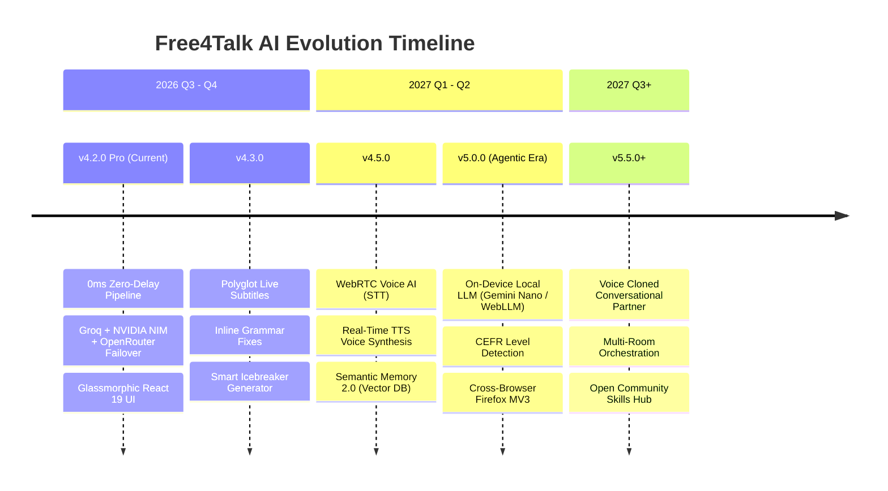
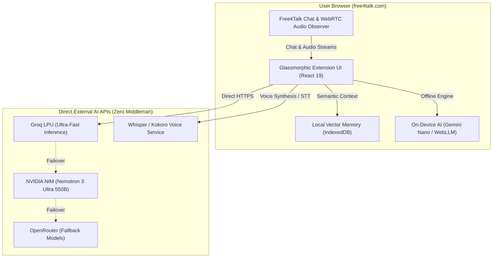

# 🔮 Free4Talk AI — Future Vision & Strategic Roadmap (2026 – 2027)

> **Architectural Vision:** Transforming [free4talk.com](https://www.free4talk.com) into an AI-augmented, privacy-first global language immersion ecosystem.  
> **Repository:** [Riajul18-19/free4talk-ai-v4.2.0](https://github.com/Riajul18-19/free4talk-ai-v4.2.0)  
> **Status:** Active Roadmap & Living Blueprint

---

## 🌟 Executive Summary & Long-Term Vision

Language exchange platforms like Free4Talk are incredible for human connection, but learners frequently experience **conversation dry spells**, **language intimidation**, **accent barriers**, and **quiet rooms**.

**Free4Talk AI** began as an ultra-fast text auto-reply bot. Our vision for the next generation is much larger: **an intelligent, multi-modal language copilot** that operates seamlessly inside your browser. It doesn't replace human speech; it empowers every user to speak with confidence, learn vocabulary in real time, and break language barriers.

Crucially, we are committed to **100% Client-Side Privacy**:
- Zero middleman proxy servers.
- Direct hardware and API execution.
- User-owned keys and encrypted local storage.

---

## 🗺️ Strategic Roadmap Overview

---

## 🚀 Detailed Phase Milestones

### 📍 Phase 1: v4.2.0 Pro — The Ultra-Fast Foundation (Current Release)
- [x] **Zero-Wait Micro-Frame Dispatch**: Replaced artificial delays with 0ms instant trigger and 15ms DOM micro-checks.
- [x] **Tri-Engine Intelligent Failover**: Primary Groq (LPU speed) ➔ Secondary NVIDIA NIM (Nemotron 3 Ultra) ➔ Tertiary OpenRouter (Free Auto-Routing).
- [x] **Concurrent Background Persistence**: Detached disk write locks from API dispatch for 5x–8x faster replies.
- [x] **Dark Glassmorphic UI**: High-performance React 19 interface with hardware-accelerated paint containment.
- [x] **Client-Side Zero-Log Architecture**: Direct HTTPS API calls with zero intermediate data relays.

---

### 🎙️ Phase 2: v4.3 – v4.5 — Multi-Modal Audio & Live Polyglot Engine (Near Future)

The next step is bridging the gap between text chat and voice conversations:

#### 1. Real-Time WebRTC Voice AI (Speech-to-Text & Text-to-Speech)
- **Whisper STT Integration**: Captures incoming WebRTC audio streams in Free4Talk rooms and generates live transcriptions on your screen.
- **Natural Voice Synthesis (TTS)**: The AI can vocalize its responses directly into the virtual microphone channel using low-latency Web Audio API and Edge TTS / Kokoro models.
- **Hands-Free Conversational Companion**: Allows users who are driving, cooking, or walking to practice spoken conversations effortlessly.

#### 2. Live Polyglot Subtitles & Bilateral Translation
- **Instant In-Room Translation**: Non-native speakers can see instant side-by-side translated subtitles for any speaker in the room.
- **Slang & Idiom Demystifier**: Hover over conversational idioms to see instant cultural and contextual explanations.

#### 3. Intelligent Room Icebreaker & Topic Engine
- Detects periods of awkward room silence (> 30 seconds of inactivity).
- Generates engaging, culturally sensitive discussion questions tailored to the room’s language learning level.

#### 4. Semantic Memory 2.0 (Client-Side Vector Embeddings)
- Transition from basic keyword matching to **local vector embeddings** via Transformers.js and IndexedDB.
- The AI will remember multi-session context, past discussions with specific usernames, and individual learning progress without uploading data to any external server.

---

### 🧠 Phase 3: v5.0 — The On-Device Autonomous Language Tutor (Mid-2027)

#### 1. 100% Offline Local AI (Zero API Keys Required)
- Leverage **Chrome Built-in AI (`window.ai`)** powered by Gemini Nano.
- Optional **WebGPU WebLLM integration** (running Llama 3 8B or Phi-3.5 directly on your GPU inside the browser).
- Benefit: Total privacy, zero cost, and zero API quota limitations.

#### 2. Adaptive CEFR Language Coach (A1 to C2)
- **Automatic Proficiency Assessment**: Evaluates the learner's vocabulary and grammar level based on their typed and spoken input.
- **Interactive Correction Mode**: Instead of just replying, the AI provides gentle, constructive corrections:
  > *"Great sentence! To sound more natural, you could say 'I have been living here for two years' instead of 'I am living here since two years'."*
- **Vocabulary Bank & Spaced Repetition (SRS)**: Automatically extracts newly learned words into an Anki-compatible flashcard deck.

#### 3. Cross-Browser Ecosystem
- Dedicated builds for **Firefox (Manifest V3)**, **Microsoft Edge**, **Brave**, and **Kiwi Browser (Android)**.

---

### 🌐 Phase 4: v5.5+ — The Open AI Conversational Hub (Long-Term Vision)

- **Community Persona & Skill Marketplace**: An open repository where educators and language teachers can publish custom bot prompts (e.g., "IELTS Examiner", "Spanish Job Interviewer", "Japanese Keigo Master").
- **Multi-Room Coordination**: Intelligent bot monitoring across multiple study rooms with instant ping notifications when relevant discussion topics appear.
- **WebRTC Custom Voice Avatars**: Low-latency voice cloning allowing users to practice speaking with diverse regional accents (British, Scottish, Australian, American, etc.).

---

## 🏛️ Future Architecture Blueprint

---

## 💡 How You Can Shape the Future

Free4Talk AI is 100% community-driven and open-source. Here is how you can contribute to this roadmap:

1. **Vote on Features**: Check open [GitHub Issues](https://github.com/Riajul18-19/free4talk-ai-v4.2.0/issues) tagged `roadmap` and upvote your favorite ideas.
2. **Submit RFCs**: Have an idea for WebRTC audio capture or local embeddings? Create an issue with the prefix `[RFC]`.
3. **Contribute Code**: Read our [CONTRIBUTING.md](CONTRIBUTING.md) and pick up an issue marked `good first issue` or `help wanted`.
4. **Follow Community Rules**: Ensure all developments respect our [RULES.md](RULES.md) and [SECURITY.md](SECURITY.md).

---

*Together, let's build the future of frictionless global communication! 🌍✨*
